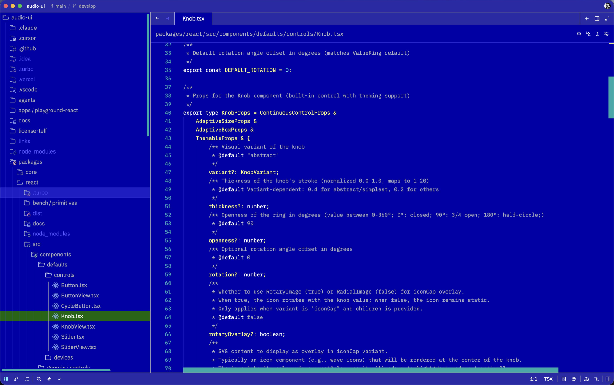

# Borland for Zed

The blue editor of Turbo C, Turbo Pascal and Borland C++, as a theme for
[Zed](https://zed.dev).



## The colours

One rule for every language, the one those IDEs used:

| Colour | Used for |
|---|---|
| White | keywords, and the words that behave like them: `true`, `null`, `self`, `this`, built-in types |
| Light cyan | strings, numbers, inline code |
| Light grey | comments and docstrings |
| Light green | preprocessor lines, macros, attributes, decorators |
| Yellow | everything else |

The rest of Zed follows Turbo Vision: blue windows with grey frames, cyan
scrollbars, a green bar on the selected item, and a terminal that looks like
the DOS prompt. Every colour is one of the sixteen of PC text mode, some of
them with a little transparency.

## Install

In Zed, open the extensions page (`zed: extensions`), search for "Borland" and
install it. Then pick it with `theme selector: toggle` (`cmd-k cmd-t` on
macOS).

## Settings that complete the look

```json
{
  "theme": "Borland",
  "cursor_shape": "underline"
}
```

A VGA font as `buffer_font_family` finishes the job, for example one of the
IBM VGA fonts of [The Ultimate Oldschool PC Font Pack](https://int10h.org/oldschool-pc-fonts/).

## Why the menu bar is not grey

Zed draws all its interface text in a single colour. Black text on grey bars
would force light pop-ups, where the bright code colours shown in completions
and hovers become hard to read. So the bars stay blue.

## Licence

MIT. Borland, Turbo C, Turbo Pascal and Borland C++ are trademarks of their
respective owners. This theme is not affiliated with them.
